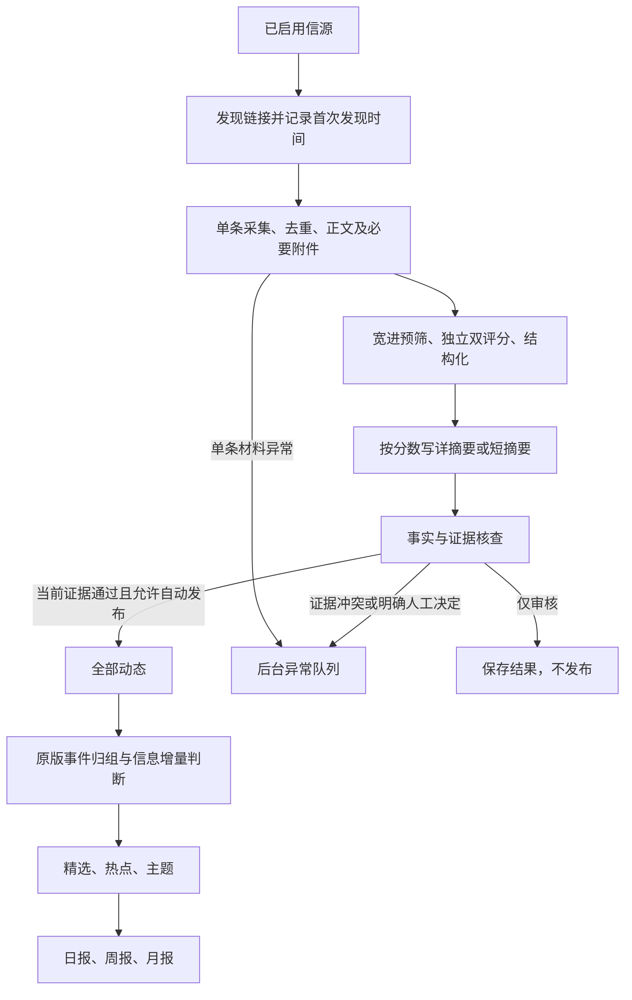

**资讯自动流转改造方案与执行清单｜2026-10-24**

> Archived project snapshot; dates and claims describe that stage, not current live state. Local paths and private deployment locations are redacted. Local-only evidence is catalogued in provenance; its links are not copies of the raw evidence. See [current status](../../current-status.md) and [source/hash inventory](../../provenance/source-manifest.json).


本稿为 v1，架构与普通新闻审核设计已被[原 AIHOT 引擎优先方案 v2](AIHOT-native-flow-implementation-plan-v2-20261024.md)替代。v2 以原生处理链和读者效果为目标；本稿的采集故障、存量迁移和测试细节仅在与 v2 一致时沿用。

目标是让本站成为持续运行的行业资讯平台：已接入信源发现新内容后，系统自行采集、判断、写摘要、核事实、进入全部动态、归组、精选、计算热点和成刊；管理员处理异常、纠错和明确要求人工决定的事项。

本方案基于已完成的[全流程审查](AIHOT-flow-audit-20261024.md)，本站基线为 `a5a0f8c064d5c82a707af2f170582338bb8ff10e`，上游基线为 `b3998dc6fc138eb9659f33f55eb38c1c716f0d57`。主工作目录仍停在 `605ac218a44a724bbcbd2c616706b331191c4ca5`，实施不能从该目录的文件内容直接开始。运行数字采用审查保存的 10 月 23 日 23:37—23:38 UTC 快照，本轮没有重新查询生产。

这是修改方案，尚未实施；没有修改仓库、生产配置、业务数据或调用业务模型。下面的字段名和状态调整属于拟议设计，实施时需同步数据库约束、共享类型和界面。

**一、先确定最终产品行为**



| 内容情况 | 改造后的处理 | 人工是否必经 |
| --- | --- | --- |
| 来源在自动处理范围、资料可用、普通行业资讯 | 自动预筛、评分、写作、事实核查，通过后进入全部动态 | 否 |
| 分数未到精选线，但相关且摘要有依据 | 自动发布短摘要或适当详摘要，留在全部动态；符合原归组条件的仍参与事件判断 | 否 |
| 分数够、事实清楚、有信息增量 | 归组完成后自动进入精选；按原算法决定是否成为热点、进入日报 | 否 |
| 官方政策、通告的客观消息 | 原文及所需附件完整、机构/时间/条款表述有依据时，可以自动发布事实摘要 | 不因“政策”二字一律要求人工 |
| 法律适用性解释、矛盾条款、脚注无法对应、必要附件缺失 | 停在具体文档及具体问题，等待补证或人工处理 | 是，限异常或解释性内容 |
| 用户指定“只审核，不发布” | 保存评分、草稿和核查结论，禁止发布入队 | 是；必须另有明确发布决定才改变用途 |
| 明显无关、明确撤回、人工明确拒绝 | 留审计记录；不出现在公开列表、详情、RSS、API、MCP、搜索等出口 | 不自动翻案 |
| 历史材料 | 按真实日期归档，不贡献近期新闻、热点或近期刊期；大批历史付费整理仍采用有界批次 | 不阻塞近期资讯 |

保留现有行业分类、五维评分结构、噪声标准以及 `60/65/76` 门槛。先修流转，再用用户已标注样本校准；不通过降低分数、修改发布日期或增加无关来源制造产量。公开范围继续通过统一 `publication/` 读取层控制，站内默认仍是摘要和原文链接。

**二、架构选择：复用现有执行器，收敛公开状态**

保留现有 `fishery.flow` 作为唯一的行业处理执行器，沿用它的任务所有权、串行预算约束、阶段回执和重启恢复。它负责把可信材料送入原有选材与发布能力。核心 `article → revision → analysis → publication → event/report` 继续承担文章身份、公开内容和下游结果；`fishery_documents/observations` 承担原件、附件、页码与版本证据。

不另建工作流引擎、候选队列、事件系统或费用账本。已存在的采集进度、任务、pg-boss 队列与回执足够完成这次改造。归组核心与上游一致，保留；共享发布器保留。模块的独立读者入口收敛为核心 publication 的视图，保留证据详情展示，撤掉第二套关键词分类和发布资格计算。

复用 `runSelectionPrefilter`、`runSelectionScores`、`runStructure`、`scoresSelect`、`shownScore`、`UNDERSTAND_FLOOR`、`normalizeAnalysis` 等已有函数。第一阶段保留本站带逐句证据的写作输出，采用原版高/近门槛详写、低分短写的分支。不能直接把整个 `runAnalysis()` 接进受控执行器：当前原版部分写作函数直接调用模型，且有并行步骤、不同输出额度，会绕开本站逐阶段输送假设。若随后统一写作函数，只增加实际需要的调用注入，不制造通用插件框架。

**三、七批修改，按依赖交付**

| 批次 | 交付内容 | 主要修改位置 | 开始条件与交付门槛 |
| --- | --- | --- | --- |
| 0：建立实施基线 | 明确部署 SHA、现有任务和发布清单、专项禁止发布名单、预算及可回退版本 | 新隔离工作区、部署检查清单；不改共享主目录 | 后续每次集成都基于实际部署版本；旧状态有可核对清单 |
| 1：采集持续推进 | 按文档隔离错误、partial 保存进度、首次发现落库、近期优先、同步登录页过滤修复 | `column-batches.ts`、`column-progress.ts`、`column-db-progress.ts`、`archive-worker.ts`、`store.ts`、`import-batch.ts`；核心 `content/extract.ts`、`sources/web-list.ts` | 一个坏附件不阻挡同源其他新稿；重启不重置首次发现时间 |
| 2：发布语义和事实资格 | 拆开核查结果与发布意图，删除普通资讯双人工必经；修正“内部合格”实际发布的问题 | `flow.ts`、`ai-review.ts`、`automatic-flows.ts`、`reader.ts`、`publication-bridge.ts`、`publication-queue.ts`、`web/flow.tsx`、模块 contracts 与 migrations | 自动稿完整通过；仅审核稿绝不产生发布任务；真实人工记录不被机器伪造 |
| 3：恢复全部动态与精选 | UNKNOWN 继续、低分短写、结构未知与不可发布分开、归组接收合格低分文章；分类标签只保留一份 | `selection.ts`、`flow.ts`、`news-structure.ts`、`news-editorial.ts`、写作/核查提示词、reader/bridge | 高分、低分、重复、事实未知四类均进入正确出口；剩余调用预算计算同步修正 |
| 4：来源与自动运行配置 | 一处来源能力、一份运行授权、同页显示生效状态；取消重复源码名单；修正规则版本与恢复语义 | `official-columns.ts`、`automatic-flows.ts`、`processing-eligibility.ts`、`manual-processing.ts`、工作台与运行页 | “已采集未派发”有准确原因；服务重启后无需人工逐稿启动 |
| 5：下游自动成刊 | 复用按日历的补刊、逐期错误隔离；恢复事件综述和周月总述的受控自动生成 | `news-editorial.ts`、核心 `reports/compose.ts`、`events/digest.ts`、模块队列与运行页 | 全部动态→归组→精选→应到刊期跑通；缺输入、平静日、缺期区分；新文案有核查 |
| 6：存量迁移和分批上线 | 逐类处理旧任务、迁移状态、完整本地验证、限定来源试运行、观察后扩到目标来源 | 新迁移、显式运维回填工具、既有测试、`docs/deploy.md`、相关说明和配置样例 | 保留历史和预算，正常资讯无人值守，异常可解释且可恢复 |

批次 1 与批次 2 可以由两个实施分工并行；批次 3 依赖批次 2 的状态约定。批次 4 的来源配置可与批次 3 并行，但 `flow.ts`、公共类型、迁移编号由一个集成负责人维护。批次 5 在全部动态及读时资格稳定后集成。每批先交付代码、针对性验证和差异清单；不把相互依赖的半套发布规则分开发到生产。

**四、逐项执行设计**

**4.1 采集失败与进度**

当前 `columnDbProgress.finish()` 只在整批 success 时保存游标，partial 会记来源失败并丢弃已计算进度；因此需要同时修改采集结果分类、进度计算、数据库提交和源健康累计。

1. 可信列表成功获取后，成功项和失败项都留下持久记录。复用 `source.cursor.fisheryColumnProgress` 的 `completedUrls/pendingUrls/retryUrls`，partial 也提交有效的 `after`；`fetch_runs` 继续记录 partial 及逐项原因。
2. `advance()` 在失败项已经进入持久重试记录后允许推进后续列表；翻页型目录和回读最新列表型来源分别验证，不能只修新闻源的分支。
3. 来源失败计数只累计列表不可用、来源身份/权限/robots 问题或整体解析损坏等源级故障。一个文档的 PDF 映射错误、404、超限只标该文档；不把三次相同附件错误当作三次整源故障。来源页分别显示最近列表成功和最近完整正文成功，避免列表健康掩盖正文持续失败。
4. 复用现有有界重试能力。已明确不能自动修复的路径/脚注问题进入异常队列，重试不挤占全部新稿槽位。真正的来源访问拒绝仍停止对应动作，不能通过放宽域名或路径校验绕过。
5. JFA 两条已知附件路径失败作为回归样本；修复后证明其他新条目能被发现和处理，不能仅证明这两篇不报错。恢复旧暂停时，从已保存的 partial 轮次和 manifest 核对成功项、失败项及游标，按真实错误分类更正计数，不统一清零。NPFC 脚注歧义保持待核条目，其余可用资料继续采集。`importBatch()` 的整批归档完整性预检也要区分单项不可用与证据篡改/来源绑定冲突，后者继续阻止受影响导入。

**4.2 及时发现、日期和吞吐**

在列表抓取时立即记录每个待抓 URL 的首次发现时间。最小实现是在现有 cursor 增加有界的 `firstSeenByUrl`，时间取已存列表请求回执，并保留 batch/receipt 定位；正文导入时写入已有 `articles.discovered_at`。已存在文章不重置该值；旧数据没有可靠发现凭证就保留旧值，不反推“本来应该更早看到”。

列表发现、详情抓取、模型处理使用各自已有队列和优先级。将业务源“一小时一个详情且新稿/修订轮流”的配置改成有界批次：初始复用现有每轮最多 5 条能力，新稿优先，同时保留有界修订检查槽位，单条失败重试不能吃掉全部新稿容量；来源限速要求更严时服从其限制。所有列表候选先被记录，即使正文尚未抓完，也不丢失真实发现时点。运行页显示最老待抓年龄和积压数，依据实际积压调整节奏，不另加高并发抓取系统。连续三个正常周期积压增长即判容量验收未通过，不能靠扩大日期窗口掩盖。

保持三个不同口径：列表回看窗口用于发现；首次发现与原发布时间的 48 小时差用于近期/历史；政策施行、申报截止等业务日期用于内容解释。统一 source timezone 和日期精度，不在不同步骤分别硬编码北京、日本或 UTC。仅有日期时保留精度与可确定时间区间，优先补可信发布时间；48 小时边界无法确定的材料保守归历史并显示原因，不能伪造精确小时。7 天展示提示不再看起来像政策失效判断。

MPA 10 月 22 日那篇不得通过更改 `discovered_at`、回填虚构时分或清空 backfill 变成近期成功样本。

**4.3 自动资格与发布意图**

把现在混在 `qualified/needs_human_review` 中的三件事分开，但不复制公开状态：

| 信息 | 保存位置/性质 | 谁可以改变 |
| --- | --- | --- |
| 执行与核查结果 | 现有 flow 任务和 quality_review；增加明确的已核查结果，supported 表示证据支持 | 执行器根据真实模型回执和确定性检查写入 |
| 发布意图 | 一份运行授权派生普通稿 auto；单稿覆盖可为 manual 或 review_only | 授权配置和真实人工操作；单稿禁止优先 |
| 实际公开状态 | 核心 publications 及其当前证据绑定；界面查询实际投影/队列 | 共享发布器与撤回机制 |

普通稿从“材料程序校验通过”进入模型，取代“必须有人工 material approved”。保留人工拒绝、撤回、来源隔离的优先否决。校验涵盖来源身份、URL、正文/必要附件校验和、页数与解析状态、可解释的日期，以及本次模型输入与归档证据一致。

事实核查返回 supported 或具体缺证问题，不再把 supported 固定翻译成“等待人工终审”。机器通过后的步骤直接检查发布意图与当前证据，允许 auto 的稿件事务性排发布。`human_decision` 只记录真实人的动作，禁止用 worker 填 `qualified` 假装人工批准。

对旧 `qualified/needs_human_review` 的业务含义做一次显式迁移：真实核查结果归核查结果，真实人工决定保留原证据与审计，实际发布结果从 publications 读取。旧版模型回执原文不改写。停用的状态约束、UI 分支和硬编码 `internalOnly:true/published:false` 同批删除；保留仍有用途的证据记录，不长期运行两套审批资格。

“保存审核结果”“批准并发布”“撤回”分别体现真实副作用。review_only 稿件的保存操作不能调用 `enqueuePublication()`；显示“仅审核”时，即使核查满分、质量通过、来源随后开启 auto，也不能自动转为发布。发布消费者再核对一次当前证据和意图，防止已经排队的任务越过后来增加的限制。

**4.4 宽进筛选、两种写法、统一标签**

预筛只让 BLOCK 终止；UNKNOWN 继续双评分与结构化。后续仍不能确认行业相关性或摘要证据时再作为具体异常处理，不能在第一步把“不确定”当“明确无关”。

两次独立评分用于决定精选候选，不用于决定文章是否存在。沿用 `understandFloor` 的详写/短写区分；分数低也可以发布有证据的行业简讯。短摘要不省略事实核查，只减少写作长度与没有必要的扩展解释。

这不是只删一行 stop：需要一并修改 `runFisherySelection()`、`runFlow()`、`flowRequiredCalls()`、`approvedNewsRun()`、`currentProjections()`、`assertNewsCurrent()` 中的高分限定，特别是归组查询里的 `AND an.selected`。预算预估必须覆盖低分继续写作、结构化、核查的步骤；事实合格的低分稿可进入原版归组，仍由核心规则保证其不被错误精选。

`scope=unknown` 与“摘要无法核实”分开：可以核实的摘要允许进入全部动态；不能确认具体新闻事实的内容不伪造 fact、不入精选。保留原版综合稿、重复报道、后续进展及 hot_signal 的区别。未经接入的社交源不因此自动启用。

结构化产生的 category/tags/subjects 直接进入核心 analysis 和发布。移除读者层对摘要做关键词重分类、bridge 又写单一分类 tag 的覆盖。人工分类更正仍使用已有 editorial override。标题作为独立的已核查字段保存，不能继续用摘要第一句充当标题。

**4.5 正文降级和行业核查**

普通新闻正文补取耗尽后，若存在可信来源直接提供的、有实质内容的摘要，可以像上游一样继续短摘要流程；明确标注输入依据为来源摘要，模型只能陈述其中有证据的事实。只有标题、登录页、错误页、损坏文本仍不能写稿。

涉及附件内容的义务、额度、截止日期、例外条件与法律适用性，继续要求对应原件和必要附件。缺哪页、哪项脚注，就在该文档上报出；不把不完整文件当全文，也不让它停止同源其他新闻。摘要只能说明“机构发布了某通知”等已证事实时，应按这个有限范围写作，不推断未读取附件的具体要求。

保留一次独立的最终事实核查，核查机构、数字、日期、行为状态以及每句的原文依据。双评分判断价值，事实核查判断支持程度，二者均保留。删除生成、结构化、复核中重复进行且会互相推翻的价值/行业兴趣裁决，把相关性和价值判断分别集中到已有步骤；事实冲突仍可以停止发布。

**4.6 来源范围、派发与失败恢复**

用现有 COLUMNS 定义采集能力，删除 `automatic-flows.ts` 和 `processing-eligibility.ts` 两处写死的五源名单，改为根据已注册能力校验。保留一份 `fishery.flow.dispatch` 运行授权；采集 enabled 仍负责采集，自动处理范围仍负责付费/发布范围，在同一状态页显示合成结果，不再增加另一份白名单。

| 来源 | 计划中的落地顺序 |
| --- | --- |
| MARA、福建两栏目、JFA | 首批范围沿用已经批准的四源，修改普通资讯为完整自动主线 |
| ITF、FAO、MPA | 作为第二批明确的范围增量，采集、模型、发布、归组及出刊一并验收；只注册采集不算交付 |
| NPFC | 保留目录/政策材料用途及例外审核；不顺带开启整库付费重跑 |
| JMA | 仍是尚未上线的独立接入事项，不夹带进本轮切换 |
| 隔离来源、测试数据、其他 RSS/网页/JSON/社交源 | 保持既有范围；用本地样本证明入口兼容，不自动扩充生产信源 |

修改 COLUMNS 时把采集 profileHash 限定到真正影响抓取语义的字段，避免开启自动处理或修改显示名称让游标失效。重命名 manual processor 的误导展示，使运行页能看到它实际承担自动派发和后续任务；是否改脚本文件名与部署命令同时处理。

派发后事务记录 task/job 关联，不能把 queued 占位显示成“模型正在运行”。现有导入后派发和定时补查保留，只修规则。正常重启复用已经取得的回执；未发送的请求可继续，已取得结果的阶段可重新落库；结果未知的付费请求停止对应付费恢复并保留预留金额，不能以新任务绕过核对。明确拒绝不自动重试。基础设施失败和内容拒绝使用不同原因码。

**4.7 规则升级、公开读取和日报**

每个任务固定记录实际执行的提示词、模型和输入证据版本。常规提示词、模型或展示配置更新只影响新任务；不得仅因全局 hash 改变让所有已核查稿失效。原文/必要附件改变、撤回、发布许可缩小等真实变化仍立即阻止旧证据公开。

对确实修复严重事实错误的规则升级，先用已有回执和归档原文做离线影响核查，列出受影响稿件与原因；无法证明兼容的才进入有界复核。不能把旧回执标成新版模型已经核过，也不能为了消除 stale 批量重新付费。政策专项的 v5.5/v5.6 问题先按这一办法处理，用途仍是仅审核。

所有读者出口共用一份当前发布资格：证据版本、核查结果、用途限制、撤回与正文许可。改造读时查询，按核心文章/绑定做有界数据库判断；移除每次公共读取全站材料并重建带对账功能 `flowDetail()` 的依赖。性能是否改善用实际查询与基线验证，不预先承诺倍数。保留缓存撤回语义，API/RSS/MCP/搜索与网页一起验收。

成刊优先直接复用 `composeDueReports()` 的日历枚举、补刊和逐期错误隔离；给它透传已有 `writeOverview:false` 选项，替换模块自己“先有精选才枚举日期”的代码。判读数为零、判读后无新要闻、已有要闻分别呈现为缺输入待补、平静日、正常日报。真实无新来稿与采集/模型停机也要从来源和队列指标区分。周/月报在应有日报完整且确实全空时跳过，缺日报不能被当成平静周期。

在自动新闻、日报与无新增文案的周/月报稳定后，完成原版编辑体验：接回事件综述及周/月总述。复用原生成逻辑，把“候选生成”和“提交公开文字”分开；所有新断言用当前可公开报道核查，并经过同一预算/回执。核查通过自动提交，失败保留已核查报道列表或原有确定性导语，不挡文章和整期成刊。不能直接调用会立即落公开稿的 composer，宣称它天然经过本站事实核查。

**五、存量数据怎么处理**

迁移先输出只读清单：文档、最新证据版本、任务、真实 job、回执、核查结果、发布绑定、日期口径、单稿用途及建议动作。每类计数和抽样都要与原快照对得上；生产已变化时，以实施前的新快照重新计算。

| 现有材料/任务 | 迁移动作 |
| --- | --- |
| 已公开的 13 条历史参考 | 保留文章身份、原日期和有效核查；验证新统一读取条件下仍能正确展示。真实证据失效的按撤回规则处理，不能为保持数量而放宽 |
| 从未付费的 queued 占位 | 明确作废旧占位或接续当前版本，不假记 rejected；按新范围、日期及用途重新计算可处理性，不能批量批准 |
| 已有草稿/核查/回执的任务 | 优先复用真实结果；不因换状态机创建重复付费请求 |
| 低分但事实合格 | 按新全部动态规则恢复资格；缺写作/核查的仍需补完相应步骤，不能凭分数造摘要 |
| 人工拒绝、撤回、隔离、仅审核 | 保持限制，不能通过批量 auto 配置覆盖 |
| 历史大库 | 原件与观察保留；不当作近期新闻集中重跑和发布 |
| 已失败或付费结果未知 | 先分清未发送、已收结果、未知结果，再分别恢复；保留费用证据 |

两条重点材料单独验证：

- **MPA `292f8e02-dcde-4bb6-9839-df372a1e142a`**：两页 PDF 已完整保存，审查时没有模型任务。计划解决来源能力/运行范围分离后，它可以在明确范围内作为历史材料处理；保留日期与 backfill，不把它当新鲜资讯上线验收样本。其摘要是否最终公开由所选批次用途和完整核查决定。
- **政策 `5f67141e-47ee-4521-bd66-7e842936c02f`**：保留 PASS、72/72、12/12 supported 的原结果及 v5.5 记录；迁移时显式绑定 review_only。规则兼容性解决后仍不得排发布，不能使用“批准并发布”完成专项审核。

MARA 低分稿不再被“精选低分”直接排除全部动态；福建研讨会先用保存输入证明“举办”误判修复，再明确恢复缺失阶段；JFA 未审稿按新程序校验处理。三者均保留真实首次发现和原时间，不能把旧任务修复展示成今天的新事件。

预算沿用已有授权 key 和全部条目。审查记录为累计 53 次、估算 ¥0.699208、未决 0，现有金额上限为 ¥10；这是累计授权，不变成“每天再给 ¥10”。业务发送次数与核心 receipts 数量口径不同，不能互相重建。任何新范围/新自动综述的预算计划都计入同一授权；迁移不清零、不补造已结算。

数据库使用新的完整文件名迁移，不修改已发布迁移。新增列/约束/索引遵循一文件一条在线语句，索引使用 `CONCURRENTLY IF NOT EXISTS`；存量状态回填由独立、可核对的分批操作完成。废弃的条件、设置、定时任务、环境项、测试和说明与替换代码同时清理；既有原件、回执和真实人工决定属于保留证据，不随状态简化删除。

**六、验证计划：证明行为，不只证明开关打开**

所有开发测试使用 `_test` 或 `_ci` 数据库及本地假来源/假模型，安全阀保持关闭。规划阶段不运行测试；实施时先跑改动对应的既有测试，集成后按 AGENTS 执行一次完整必需检查。

| 验收场景 | 必须得到的结果 | 优先补入的既有测试 |
| --- | --- | --- |
| 同源 3 篇中 1 篇坏 PDF，重启后再出现 1 篇新稿 | 好稿落库、游标推进、新稿继续；坏稿可重试且不重复发现/计费，不自动停整个源 | fishery `materials.test.ts`；核心 `collection-detail-recovery.test.ts` |
| 列表先发现，详情延后；日精度/时区/48h 边界 | 首次发现不变，历史不洗新；相同输入不受机器时区影响 | fishery `business-timeliness.standalone.test.ts`、核心 `content-freshness.test.ts` / `publication-time.test.ts` |
| PASS/UNKNOWN/BLOCK，高分/低分/结构未知 | UNKNOWN 继续，低分进入正确全部动态；BLOCK 所有公开出口不可读；未知 fact 不精选 | fishery `materials.test.ts`、核心 `selected-news-gate.test.ts` |
| 普通 auto、manual、review_only、人工拒绝 | auto 不点按钮完成；manual 等真实决定；review_only 从任何入口都不发布 | fishery `materials.test.ts`、`business-guides.test.ts` |
| 发布已入队后原文/附件改变或撤回 | 旧任务不能发布，旧内容不进入网页/RSS/API/MCP/搜索/热度/报告；单文档变化不暂停整源 | 核心 `outlet-invariants.test.ts` / `public-cache.test.ts`、fishery `materials.test.ts` |
| 同稿重试、重启、两个派发时点交错 | 不重复模型发送或建立重复发布身份；未知回执不会被新 identity 绕过 | fishery `processing-lease.test.ts`、核心 `receipts.test.ts` |
| 同事件多源、重复报道、后续进展 | 单一事件关系正确，精选信息增量正确；没有两独立参与方时不强造热点 | 核心 `events.test.ts`、`hot.test.ts`、`grouping-reliability.test.ts` |
| 有判读无精选、完全无判读、缺日报、一个刊期失败 | 平静日/待补/缺期准确区分；一个失败不阻后续期；无虚构要闻 | 核心 `reports.test.ts`、`report-recovery.test.ts`、`daily-report-alerts.test.ts` |
| 综述添加原材料没有的数值或机构、依据撤回 | 不提交错误综述，文章/报告仍可读可追溯，新增文案同步失效 | 核心 `story-digest-eval.test.ts`、`report-outlets.test.ts` |

整批集成所需命令：

```bash
npm run typecheck
DATABASE_URL=postgres://127.0.0.1:5432/fishery_autoflow_test npm test
npm run build -w @aihot/web
node --test apps/web/tests/*.test.ts
node scripts/smoke.ts --base http://localhost:3000
```

新增或修改的 standalone 用例另外按现有测试启动方式运行。采集、日期、正文、精选和归组的行为变更还需用归档的公开真实样本离线对照，逐条解释前后差异；不靠生产试错替代本地回归。实施中确需补充公开样本时只抓必要样本，业务模型仍用假服务验证调用链。

**七、部署、观察和回退**

1. **准备可审阅发布包。** 包含精确 SHA、迁移文件、状态变更清单、来源范围差异、测试结果、预算变化、旧专项保护断言和回退包。实现不修改共享主目录，独立分支/工作区集成。公开访问权限、站名、条款和全文许可不随流程修复暗中变更。
2. **先在数据库副本演练。** 覆盖旧 13 条读者记录、全部现有任务与只审核政策；对迁移前后计数、内容 hash、人工决定和费用条目做差异核对。新状态与旧程序不兼容时必须提供兼容回退包，不能只准备旧 SHA。
3. **停派发、排空在途再切换。** 记录精确队列与回执状态；有未知付费结果先核对。采集能否继续取决于本批 cursor/schema 是否兼容。迁移后启动唯一处理消费者，验证租约、队列参数、时钟、真实任务/发布状态，再按清单启用首批四源。
4. **首批观察完整正常链。** 先选真实、在窗口内且属于已确认行业范围的新资讯，自动经过全部动态、归组、应有精选判定和应到刊期；全过程没有人工点素材批准或终审。最终取得两类真实正例：一条低于精选线的资讯自动留在全部动态，一条达到门槛且有信息增量的资讯自动完成精选并进入应到日报。若尚无满足条件的新稿，报告等待真实样本，不人为提分或修改时间。
5. **扩大到 ITF/FAO/MPA。** 用同一配置与同一发布流程接入；每个源显示采集、正文、派发、模型、发布的最新成功时间和具体停因。NPFC/JMA 等范围按上一节保持，不被顺带改变。
6. **观察至少 48 小时及两个日报边界。** 周/月逻辑先用固定时钟和真实归档样本在副本演练，不能声称已经经历真实月末；后续真实到期运行继续验证。启用综述前完成其独立核查、预算与撤回测试。

回退采用“停止有问题的自动动作并保全增量”：关闭该范围的自动派发和新发布，排空/停止其消费者，保留原件、回执和新取得结果；用预备的兼容版本恢复人工/只读服务。若问题涉及错误公开内容，按确切文章及版本撤回并刷新所有出口。普通逻辑错误优先前滚修复。数据库全量恢复不是默认回退方式，尤其不能丢掉切换后新增的回执与材料。

触发停止扩量的具体条件：review_only 被排发布、旧版本或撤回内容可读、同一阶段出现重复计费、预算账本不连续、消费者所有权冲突、出现系统性证据错配。单篇低分、一个源当天没新稿、一个附件待核不属于整站回退条件。

**八、最终完成标准与运营页面**

平台完成应同时满足：

- **普通资讯自动化：** 对范围内、证据可用、没有单稿限制的样本，100% 按明确规则自动到达全部动态或有原因的终点；人工操作数为 0。低分、无关、历史和异常各自可区分。
- **时延与吞吐：** 来源在既定抓取周期内被扫描；从可用正文到全部动态，首阶段目标 P95 不超过 10 分钟（来源/模型健康、预算有余的普通稿）。超过时记录具体阶段，不能把发现时间重置。样本不足时只报实际值，不报虚构 P95。
- **精选与热点真实：** 得分、归组、信息增量同时满足才精选；独立来源不足时允许没有热点，不能用发布数量充当热点。
- **发布一致：** 同一文章身份在网页、RSS、API、MCP、搜索和报告里遵守同一资格；仅审核及撤回稿公开数为 0；普通摘要不自动开放全文。
- **调度可靠：** 单条失败不会冻结整源；任务重启继续、不重复付费；没有 job 的 queued 不显示为运行中。
- **按时成刊：** 应到刊期有正常刊、平静日或明确待补原因；缺日报不被静默掩盖，一个失败不阻下一期。
- **费用可核：** 历史账本完整，每次新增付费都有对应阶段、回执和金额预留；没有预算清零或换 key 续额度。

后台保留一张流转看板，按同一时间窗展示：发现 → 材料可用 → 已派发 → 已判断 → 已核查 → 已发布 → 精选 → 入刊。旁列明确无关、低分仍发布、历史、待附件、仅审核、人工拒绝、模型失败、未知回执、范围外等原因；用 article/document/revision/task/job/receipt 的已有身份联查。各步计数采用同一批次口径，不能把存量文书总数与近期稿件混比。

上线后管理员的日常工作应是查看异常、处理少数证据问题和纠正选材。系统负责持续采集与自动流转。首要交付是首批四源和全部动态/精选/日报的真实闭环，随后扩到已采集的三条业务源并补齐自动综述；继续增加来源数量不替代这一验收。

关键证据及具体函数行号见[采集附录](intake-review.md)、[审核与发布附录](review-publish.md)、[生产停点附录](production-trace.md)、[下游附录](downstream-review.md)。所有执行前的生产数字、可用新稿与最终发布 SHA 都必须重新核对，本方案没有把审查快照当作当前运行事实。
