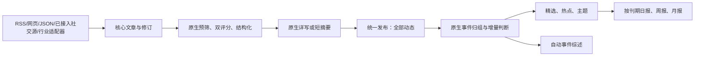

**以原 AIHOT 引擎与使用效果为目标的实施方案 v2｜2026-10-24**

> Archived project snapshot; dates and claims describe that stage, not current live state. Local paths and private deployment locations are redacted. Local-only evidence is catalogued in provenance; its links are not copies of the raw evidence. See [current status](../../current-status.md) and [source/hash inventory](../../provenance/source-manifest.json).

本版按恢复原引擎使用效果的业务目标修订，替代[上一版方案](AIHOT-autonomous-news-implementation-plan-20261024.md)的架构选择和普通新闻审核设计。此前方案偏向修通自建 fishery.flow；本版把普通资讯恢复到 AIHOT 原生处理链，行业模块承载专用采集、附件证据和专项资料工作。

**最新状态（2026-10-24 05:58Z）：源码、正常提交推送与生产四服务仍为 3a162cb5；用户解锁后，唯一 UI owner 已通过正常后台对既有 JFA 显式重评一次，随后自动分析并发布至全部。** 新预筛 f1dd PASS，receipt 47 精确匹配新 system 2d3353；双分 22/22，结构和短摘要完成，未入精选。锁屏已不构成当前阻塞。证据见[提交后快照 (local original; provenance)](../../provenance/source-manifest.json)和[业务结果 (local original; provenance)](../../provenance/source-manifest.json)。

**当前已取得“真实既有文章显式重评→自动发布”及原自然调度平静日报正例；尚未取得自然新到采集→发布、有精选内容日报、事件综述、周月报及 48 小时正例。** audit 1184 / admin:1 / requestId mvlzl1zy-a5kp30xg 只提交一次；新 analysis 2、receipts 47–51 completed。publication public/eligible、score 22、selected=false，detail found，全部 13→14 仅新增 JFA；grouping complete 但无 story/fact/digest。旧 analysis 1 / receipt 46 的 BLOCK 保留，MARA 拒发、政策仅审、原 13 条、真实日期、scope 及原 54 条账本前缀均不变。本次新增 entries 55–59，共估算 ¥0.162376；累计 59 received、估算 ¥0.897700，pending/unknown=0，原累计上限 ¥10。原自然 compose 207 在 06:14:14–15Z 成功生成 Oct24 平静日报，已判读 1、精选 0、条目 0、model=null；不是含稿日刊，无新增模型，账本仍 59/估算 ¥0.897700/无未决。

下文 fa8/d92 和 3a162cb5 重评前状态保留为阶段历史；本次重评没有新代码或部署，a5 相对源码仍为 70 路径。旧 observer 用 receipt 46 比较新 hash 的 false 不是新版判读失败，应核新 receipt 47；旧切片带出的 entry 54 也不算本次新增。JFA/MPA 列表成功、分别 2/1 个正文失败导致 partial；fetch_runs status=ok/outcome=partial，job_runs 显示 failed，不等于整源全失败。两源 failCount=0、未暂停且下一轮/进度保留；NPFC failCount=2，不能概括八源全正常。最新完整口径见[实施交付记录](implementation-delivery.md)。

本文件保留为设计基线。**上一阶段生产版本为 `d92f8eee0b053f559e0a135e26828f8081e966c6`（parent=fa8），已正常提交推送；唯一部署执行者 native_ui_ops 已完成副本预演与生产单 JFA 迁移。05:09:41Z 汇总确认 API/web/native/archive 四服务运行，旧 manual 停止，05:12 有新心跳。** 初版 69 文件提交为 `fa8eb3d26ba0da128c0686cd9738bb8213249b2f`；d92 只改显式 handover 对严格审计证明的零付费系统占位识别，21/21 定向及独立审查通过，不放宽日常拒绝门。两次均正常推送至 Maidamai/AIHOT 的 `feat/fishery-native-flow-v2-20261024`；共享主工作目录未改。当前证据见[实施交付记录](implementation-delivery.md)、[d92 部署汇总 (local original; provenance)](../../provenance/source-manifest.json)；原[implementation.patch (local original; provenance)](../../provenance/source-manifest.json)与[d92 增量补丁 (local original; provenance)](../../provenance/source-manifest.json)分别保留。

方案编制时尚未实施。对照版本为上游 `b3998dc6fc138eb9659f33f55eb38c1c716f0d57`、本站已审部署版 `a5a0f8c064d5c82a707af2f170582338bb8ff10e`；本地实现从精确 a5 建立。下文“实施前/待部署”保留为当时计划，不能视作当前状态。生产已有自然采集隔离证据；JFA 原系统 supersede 误挡经 d92 只移除两个零付费占位，audit 995 保留并新增 handover 审计。MARA 的 authorized-agent 明确拒发且已付费继续保护，指定政策仍仅审不可读；原 13 条历史 ID/日期/binding、scope/真实日期/鉴权边界保持。

**d92 阶段效果留档：自动链已部署并真实跑过旧版预筛，尚未达到真实自动出稿、成刊和 48 小时正例验收。** [05:13:07Z 真实业务快照 (local original; provenance)](../../provenance/source-manifest.json)记录 JFA 标题“11月3日から7日は「いいさかなの日」”，预筛理由“仅鱼食推广活动，未涉远洋渔业”，实际 BLOCK；不提前断言该过滤符合宽召回。未继续双评分/写作/发布/归组。累计 54 条 received、估算 ¥0.735324，新增一次 ¥0.036116，未决/unknown=0，原 53 条账本前缀保留，原累计 ¥10 不变。读取仍为 13、timeline=0；日/周/月报无正例，`reports.compose` 的窗口内 nothing judged 真实失败仍存在。部署和一次预筛执行不能替代完整效果验收，也不据此扩围或释放限制对象。

[06:03:45Z 公开读取层出口核验 (local original; provenance)](../../provenance/source-manifest.json)：源站网页详情 200/private-no-store，API all 含 JFA、selected 不含，RSS all 同 ID/原时间，既有 MCP `myhot_get_latest(all,7d)` 为 200/SSE 且无 error、目标同 API。仅回环只读验证，公网私有预览鉴权未取消，无文件写入或新模型请求。刊期源码规则已核定：未精选稿的 releasedCondition 不按 updatedAt 排除；judgedReports 看 listedCondition(end)、score、非历史及 timeline，不看 analysis 创建时间。本稿当前可计入 Oct24 日报已评分数，但 periodReports 只取精选，它不进入精选条目。composeDaily 在无精选条目但已有判读时允许安静日报；该规则随后已由自然 compose 207 验证，06:03 的 reports=[] 仅为此前快照。

[06:17:04Z 最终自然成刊证据 (local original; provenance)](../../provenance/source-manifest.json)与独立审查确认：compose 207 为 ok、generated daily:2026-10-24、failed=[]；report id 1“本期暂无入选资讯”，judged=1、selected=0、entries=0、model=null。日报 API、网页和 RSS 均 200、同日期标题。原调度自行运行，无手动 compose、改日期或新增模型；59 条完整账本、旧分析/回执及受限对象保持。这一正例只覆盖无精选条目的平静日报，不覆盖含稿日刊、周月报或其他未验收场景。

**1．用户最终应看到什么**

打开网站能直接阅读持续更新的资讯：全部动态承接可发布的行业信息，首页展示精选，同一事件聚合报道，热门体现独立来源的讨论，主题页按分类和标签组织，每天自动出日报，周/月自动汇编。管理员日常查看异常和纠正选材，不逐篇点素材批准或终审。

普通新闻目标流程直接采用原 AIHOT：

此前“所有普通资讯都先走本站逐句复核模型，再决定发布”的额外必经步骤撤出普通新闻主线。普通资讯使用原引擎的结构化、写作、命名/数值等已有约束；行业相关例子和明确写作边界放进 industry。完整原件/PDF存档可作为证据能力保留，但不让文书审核工作台成为所有新闻的入口。

用户明确要求仅审核的材料、人工明确拒绝/撤回、确有证据冲突的条目继续受其具体限制约束。法规适用性分析、跨文件义务解释等专项工作留在材料工作台；官方“发布了一份通知”的客观资讯可以走正常新闻链，正文使用到的附件事实须确实取得。

**2．原版的哪些代码直接复用**

| 环节 | 原版依据 | 本站实施目标 |
| --- | --- | --- |
| 进入处理 | [queueProcessing / processRevision](https://github.com/KKKKhazix/AIHOT/blob/b3998dc6fc138eb9659f33f55eb38c1c716f0d57/packages/backend/src/jobs/content.ts#L75) | 行业适配器完成材料入库后调用核心处理入口；普通稿不创建 fishery.flow 审批链 |
| 预筛、评分与写作 | [runAnalysis](https://github.com/KKKKhazix/AIHOT/blob/b3998dc6fc138eb9659f33f55eb38c1c716f0d57/packages/backend/src/editorial/analyze.ts#L477) | 使用原流程：只让 BLOCK 终止、UNKNOWN 继续、独立双评分、结构化、详写/短写、必要措辞修正 |
| 发布 | [processRevision](https://github.com/KKKKhazix/AIHOT/blob/b3998dc6fc138eb9659f33f55eb38c1c716f0d57/packages/backend/src/jobs/content.ts#L136)、[publishArticleTx](https://github.com/KKKKhazix/AIHOT/blob/b3998dc6fc138eb9659f33f55eb38c1c716f0d57/packages/backend/src/publication/publish.ts#L235) | 分析完成自动发布，无逐篇人工终审；全部动态与精选分层 |
| 归组与精选 | [groupArticle](https://github.com/KKKKhazix/AIHOT/blob/b3998dc6fc138eb9659f33f55eb38c1c716f0d57/packages/backend/src/events/group.ts#L234) | 复用原算法和分数＋归组完成＋信息增量条件，不再维护第二套精选资格 |
| 事件综述 | [registerEventJobs](https://github.com/KKKKhazix/AIHOT/blob/b3998dc6fc138eb9659f33f55eb38c1c716f0d57/packages/backend/src/jobs/events.ts#L10) | 恢复原归组后的综述任务；允许的模型请求全部纳入本站既有预算与回执 |
| 热点与定时任务 | [ENGINE_SCHEDULES](https://github.com/KKKKhazix/AIHOT/blob/b3998dc6fc138eb9659f33f55eb38c1c716f0d57/apps/worker/src/schedules.ts#L26) | 使用原热度计算、采样、漏任务扫描、恢复及成刊调度；逐项核对部署实际启用 |
| 日报与周月报 | [composeDaily](https://github.com/KKKKhazix/AIHOT/blob/b3998dc6fc138eb9659f33f55eb38c1c716f0d57/packages/backend/src/reports/compose.ts#L89)、[composeDueReports](https://github.com/KKKKhazix/AIHOT/blob/b3998dc6fc138eb9659f33f55eb38c1c716f0d57/packages/backend/src/reports/compose.ts#L305) | 完整恢复原按日历出刊、补刊、平静日及缺输入语义；周月总述使用原生成与落地保护 |
| 读者页面与公开出口 | 上游 `apps/web`、`publication/`、API/RSS/MCP 路由 | 以原版精选、全部、热门、主题和刊物页面为主要体验；保留本站名称、品牌、行业内容 |

原版已有的调用关系就是实施参照；相同能力优先保留或恢复原函数，不在 fishery 模块里再写功能相同的分支。具体不能直接恢复的地方必须列出证据和必要适配，不能默认把已有自建流程保留为最终架构。

**3．保留、撤出、适配的边界**

| 类型 | 处理 |
| --- | --- |
| 行业化配置 | 保留信源、时区、来源分级、分类标签、主题、五维评分标准中的行业例子、站点品牌及模型配置；不擅自改既定选材标准和数字门槛 |
| 行业采集 | 保留官方栏目、PDF、附件、原件归档与版本观察；输出统一核心 article/revision，正文采集质量不通过就只阻塞对应条目 |
| 原生资讯功能 | 直接复用原预筛、双评分、写作、全部动态、精选、归组、热榜、主题、综述及刊物 |
| 普通新闻双人工关卡 | 撤出普通新闻主线；不自动写 approved/qualified 冒充真人审批 |
| 普通新闻额外模型复核 | 撤出通用必经链；专项材料保留。新闻发布不再等待另一套 fishery quality/human 状态 |
| 第二套投影与分类 | 普通新闻不再经 fishery reader/bridge 重新分类、制造 editorial_override 或另算资格；核心 analysis/publication 是唯一公开依据 |
| 专项工作台 | 保留原件查看、逐句复核、人工修订、业务指南、仅审核任务；其工作不拖住资讯流水线 |
| 真实限制与资金边界 | 保留撤回、隔离、来源许可、仅审核用途、回执和累计预算；接原生任务时一起适配 |

“历史材料”和“当前资讯”仍按真实时间区分。正文无法取得时，普通文章按原版可用摘要降级规则处理；仅有标题或错误页不写稿。普通历史参考是否整理按已授权范围和优先级处理，不能修改时间让它进入今天。

**4．具体实施，分六批交付**

| 批次 | 执行工作 | 必须交付的证明 |
| --- | --- | --- |
| A：建立原版行为基线 | 在隔离环境运行固定上游和本站，用同一组本地来源/假模型响应比较：PASS/UNKNOWN/BLOCK、低分/高分、综合稿/单事件、同源失败、日报空输入。列出“保持原版”和“必要行业差异”清单 | 所有差异有原因；没有依赖原站私有运营数据的假设 |
| B：接通原生处理与费用 | 行业导入进入核心 queueProcessing；注册所需 content/event/report 消费者和调度。将原累计授权接到每次原生付费请求，覆盖分析、措辞、归组、综述、翻译、周月总述等实际可能触发的步骤 | 流程启动不会多开不在范围内的付费任务；所有请求有回执，预算和历史账本连续 |
| C：撤出普通新闻审批分支 | 普通新闻停止创建/消费 fishery.flow；替换其人工门、额外复核和 reader/bridge 新闻路径。人工限制与专项任务保留独立用途绑定 | 一篇普通资讯从入库到全部动态无需人工；仅审核政策不能被核心 sweep、手动重放或 source republish 发布 |
| D：修采集与实际配置 | partial 也保存游标、文档错误隔离、首次发现落库、修订与新稿合理分配；统一来源能力与一份自动运行范围；同步上游登录页过滤修复 | 坏附件持续存在时，同源新稿仍正常前进；注册源不等于自动扩展模型/公开范围 |
| E：恢复完整读者效果 | 原版全部动态、精选、主题、热点、事件综述与日/周/月报完整运行；撤掉模块复制的按精选推刊期逻辑、重复分类和普通新闻资格重建 | 网页、RSS、API、Agent Markdown、MCP同源同资格；正常有内容的刊期自动完成 |
| F：迁移、验证、分批上线 | 副本预演，逐项处理旧任务/绑定，关闭旧普通新闻消费者，启动一套新主线；先原四源，后 ITF/FAO/MPA，观察至少48小时与两个日报边界 | 原有效历史记录保留、仅审核不放行、无双重采集/处理/付费；所有近期候选有结果或明确停因 |

B 的原生任务接入与 D 的采集修复可以并行；C/E 依赖 B 的统一预算和限制适配。迁移相关核心类型、数据库变更和任务注册由一个集成负责人管理。

**4.1 原生 worker 的接入必须是完整迁移**

现有部署是受控 archive/manual processor，不能把“开总 worker”当成完成迁移。需要逐项列出原生队列、定时任务、来源归属和所有付费调用。每个来源只由一个采集器负责，每篇普通文章只走一个处理执行者。原 flow 对普通新闻的生产者、消费者、重试和维护分支同批退役，专项用途需要的部分保留。

原 `runAnalysis()` 有评分/结构并行，部分写作函数直接调用底层模型，额度与本站旧试运行输送不同。实施要在实际调用边界统一绑定授权、回执和金额预留，核对每个请求的容量，必要时给具体函数补调用注入或先限制执行并发。目标仍是运行原分析链，不能因为迁移麻烦把自建分析链永久留下。并行时预留金额必须原子扣占；没有通过此验证前不启用生产模型。

保留现有累计预算、模型/端点和已批准的请求容量限制；超出当前授权的调用计划单独列入发布清单，不在打开 worker 时隐式放宽。推送、邮件、飞书、IndexNow 等外部动作按各自已有授权和安全阀，不能跟随资讯主线整体打开。

**4.2 专项限制贯穿原生链**

原生任务不能依赖 fishery 的人审状态来区分专项用途。将“仅审核/人工拒绝/撤回”等真实限制持久绑定到文档或核心文章身份，改版、重新采集和新建任务不能清掉它。

处理入口和消费者在开始工作时核对用途，实际付费请求前再次核对授权；发布器与统一读取层核对发布限制。优先使用现有模块 publication 接口；处理侧缺少必要入口时，只增加一个用途明确、由模块提供判断的许可接口，覆盖 sweep/重试/重放，不让核心直接导入 fishery 规则。

普通资讯默认遵循原引擎自动发布。专项限制只命中明确对象，不能重新演变为全站逐篇人工确认。

**4.3 原版效果也包括前台结构**

前台主入口采用精选、全部动态、热门、主题、日报/周报/月报；新闻详情保留来源链接、摘要、事件关联和原版阅读结构。后台材料工作台作为管理入口。分类标签来自原生 structure，移除摘要关键词二次重分类；同一事件按原版聚合与代表报道展示。

保留本站已有名称和品牌，不使用 AIHOT 名称或 Logo。桌面与手机导航都按最终栏目实际检查。既有私有预览鉴权、条款、全文与对外推送权限不因恢复页面结构而暗中改变；是否公开上线作为发布配置单列。

**5．旧材料和已有费用的迁移**

先取得实施时的新快照，输出文档/文章修订、任务、job、回执、当前可读绑定、用途限制清单。旧文章身份与真实日期不变；不根据物理 publications 行数猜哪些内容当前可读。

- 现有有效的13条历史参考保留其原始证据和真实决定，仍走相应历史阅读用途；原件或限制真实变化另按当前规则处理。
- 从未付费的普通新闻占位任务明确标记被新处理链接管，防止两条链同时消费。已付费结果能够证明输入、目的、规则和输出语义兼容才复用，不能拼成“原版已跑过”的假 analysis。
- 人工拒绝、撤回、隔离及仅审核不批量释放。低分稿可按新全部动态规则补齐必要写作和发布，但不改原时间。
- MPA `292f8e02-dcde-4bb6-9839-df372a1e142a` 保留真实日期及历史身份，不能当近期成功样本。
- 政策 `5f67141e-47ee-4521-bd66-7e842936c02f` 的 PASS、72/72、supported 原结果保留，仍只审核、不发布。离线处理旧规则兼容性不改变用途。
- 费用沿用原账本：审查时累计53次、估算¥0.699208、未决0、上限¥10。实施前重新核对，不清零、不换key重新给额度，不以核心receipt数量重建发送账本。

新增迁移遵循仓库单语句、完整文件名、在线索引约定；大批回填独立执行，不修改旧迁移。停用的普通新闻分支、任务、settings、环境项、说明和旧测试预期同步清理；专项仍在使用的表与历史回执继续保留。

**6．按原版效果验收，而不是按新增功能验收**

1. **自动阅读体验：** 范围内真实普通资讯无需素材审批和人工终审就进入全部动态；读者不用打开材料工作台才能看到新闻。
2. **全部动态与精选：** 真实低分相关稿进入全部动态；真实高分、有增量的新稿归组后进入精选。模型分数如实保留，不强行保证某条成为精选。
3. **事件与热点：** 多源报道聚在同一事件，后续进展正确关联；满足原独立参与方条件时进热点，自动生成事件综述。
4. **刊物：** 日报自动编排；周月报按原规则汇编并生成总述。无判读、平静日、缺刊各自有准确结果，失败可以补刊；不把零输入静默当成功。
5. **持续运行：** 单篇坏附件不冻结全源；列表发现时间不被排队改写；重启后继续、不重复调用模型；每个停点可从运行页解释。
6. **一致与边界：** 网页、RSS、API、MCP、搜索和刊物遵循相同公开资格；指定仅审核、撤回与失效证据仍正确受限。
7. **与上游的行为对照：** 使用同一固定来源样本和模型响应回放，比较各步结果与出口。所有剩余差异必须来自已确认的行业配置、专项用途或预算适配，不能继续隐藏一套额外审批主线。

实施阶段按仓库要求运行 typecheck、隔离测试库测试、web build/test 和本地 smoke；补充上述行为回归放进既有测试。采集、日期和正文变化用归档真实页面离线重放并逐条解释差异。真实周/月边界未发生前，使用固定时钟验证并明确区分演练与实际出刊。

上线先让 MARA、福建两栏目、JFA 完成完整链，再扩到 ITF/FAO/MPA。NPFC保留既有资料处理范围，JMA保持独立接入事项。普通资讯迁移期间采用一套执行者；先停止旧派发、排空/核对在途请求，再切换新链。出现用途误放行、证据错配、重复计费或账本不连续时，停止对应自动动作并保留所有增量，用预备的兼容版本回退，不恢复旧库抹掉已经发生的费用。

上游公开的是引擎和示范信源，不包含原站完整运营源及数据。本方案以源码定义的自动流转、读者页面和成刊行为为验收对象；每日实际条数与热点密度取决于本行业信源的真实产出。
